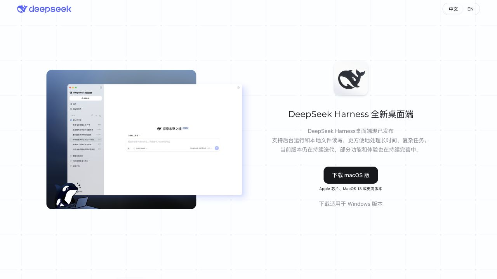
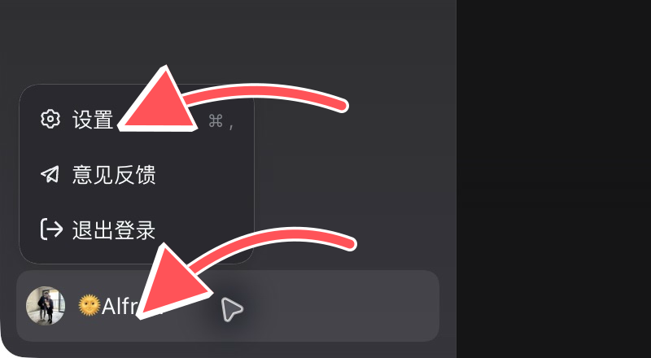
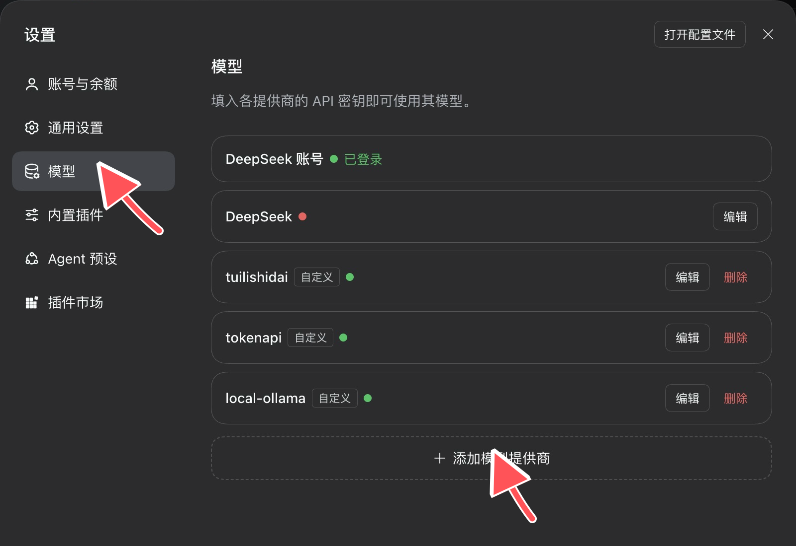
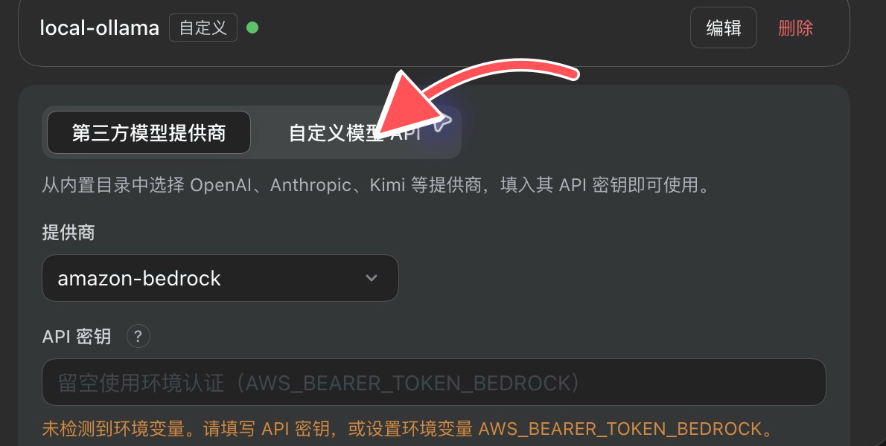
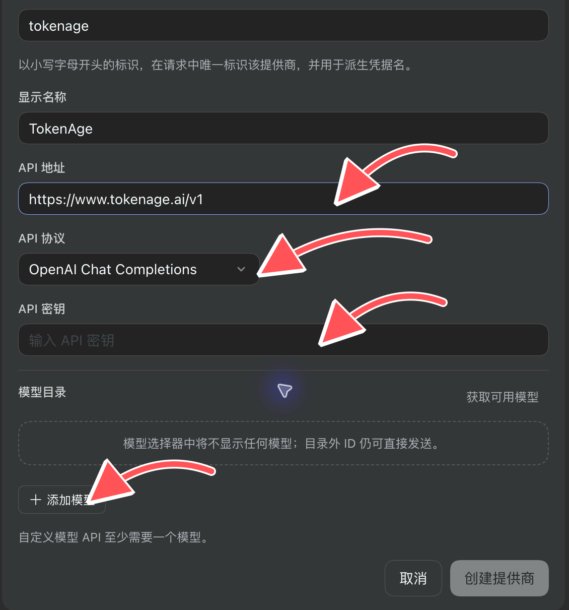
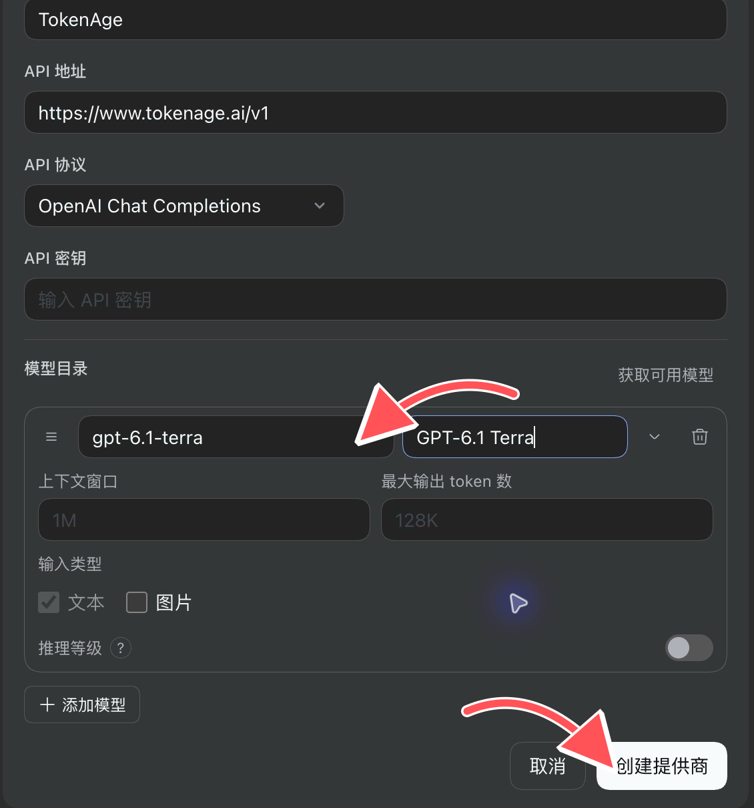
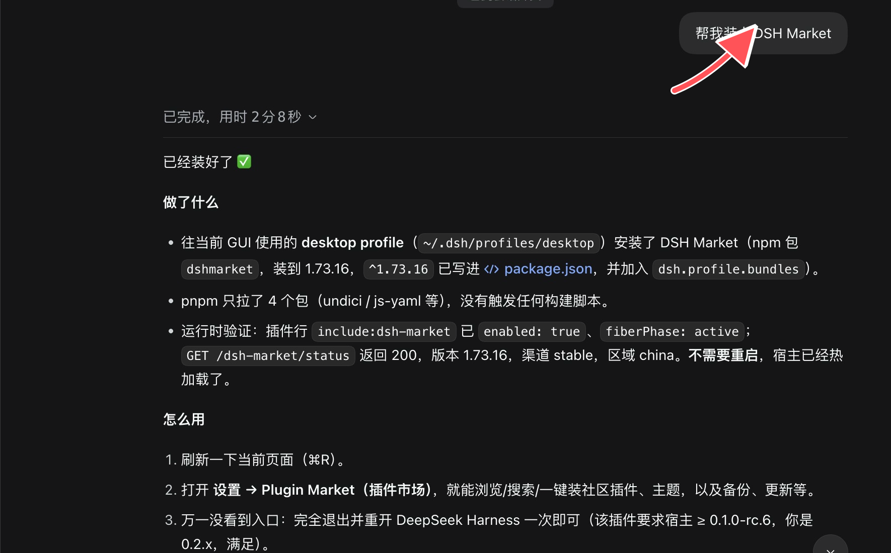
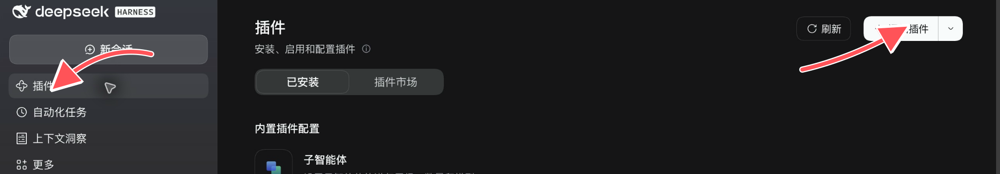
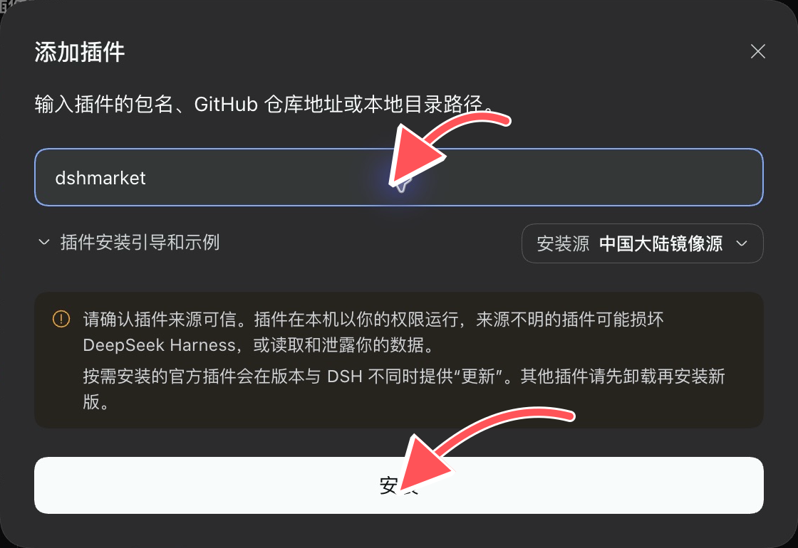
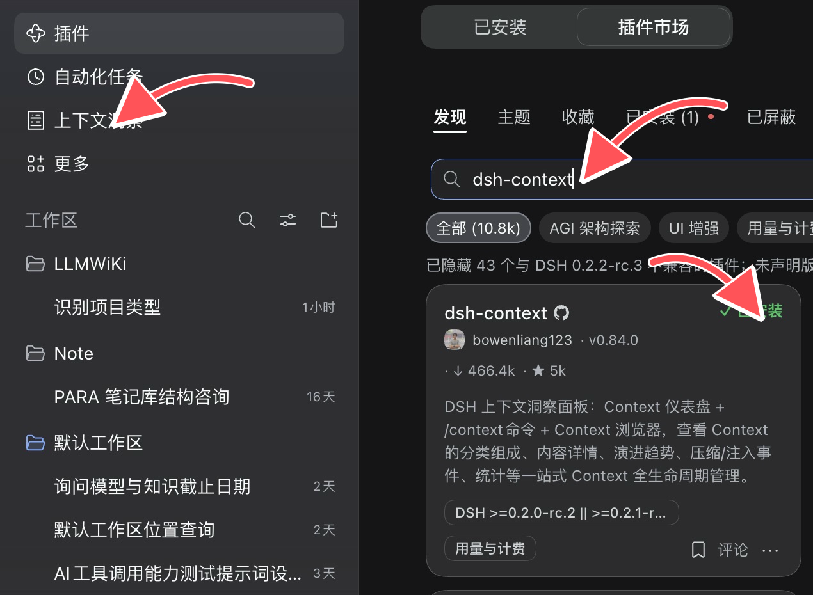

# DeepSeek Harness 接入 TokenAge 简明教程

> 按 2026-11-14 的官网资料与本机 macOS 应用界面整理。版本更新后名称和位置可能变化。本文未实际配置密钥或测试调用。

## 1. 下载与安装

1. 打开 [DeepSeek 官方下载页](https://www.deepseek.com/zh/download/)，找到上半部分的 **DeepSeek Harness 全新桌面端**，选择 macOS 或 Windows；下半部分的手机 DeepSeek 客户端不是这里的桌面应用。
2. **Mac**：官网当前列出 Apple 芯片、macOS 13 或更高版本。下载后打开 `.dmg`，将应用拖入「应用程序」，再从「应用程序」启动。Intel Mac 的支持情况请以官网当时说明为准。
3. **Windows**：下载 Windows 安装程序，双击并按向导完成安装，然后启动应用。

## 2. 准备 TokenAge 信息

1. 打开 [TokenAge](https://www.tokenage.ai/)，注册或登录，按平台要求准备可用额度。
2. 在「API Keys」页面创建并复制 API Key；不要向他人分享或放入笔记截图。
3. 在模型广场搜索 `gpt-6.1-terra`，复制平台显示的**准确模型 ID**，并确认账户可访问该模型。TokenAge 的 [文档概览](https://www.tokenage.ai/docs)说明可从模型广场或模型列表取得 ID；实际可用性和费用以平台当前显示为准。

## 3. 配置自定义模型 API

**第一步：打开设置。** 在窗口左下角点击头像或账号，再点击弹出菜单中的「设置」。

**第二步：添加提供商。** 在设置左侧点击「模型」，再点击「添加模型提供商」。已有提供商列表因人而异。

**第三步：选择自定义接口。** 点击「自定义模型 API」标签。

**第四步：填写接口信息。** 向下滚动表单，填写以下内容：

- **Provider ID**：例如 `tokenage`；需以小写字母开头，且不要与已有提供商重复。
- **显示名称**：例如 `TokenAge`。
- **API 地址**：`https://www.tokenage.ai/v1`。
- **API 协议**：`OpenAI Chat Completions`。
- **API 密钥**：粘贴自己的 TokenAge API Key。截图中为保护密钥而留空。

> 此处填写的是 TokenAge 的 **Base URL**，不要填 `/v1/chat/completions` 完整请求地址，也不要重复添加 `/v1`。TokenAge 官方文档列出的根地址为 `https://www.tokenage.ai/v1`，聊天接口为 `/v1/chat/completions`；Harness 表单中的 API 地址提示也采用 `/v1` 根地址。

**第五步：添加模型并创建。** 在「模型目录」点击「获取可用模型」并选择 `gpt-6.1-terra`；也可以点击「添加模型」，在「模型 ID」中填写 `gpt-6.1-terra`，显示名称可填写 `GPT-6.1 Terra`。请以 TokenAge 模型广场显示的精确 ID 为准，并确认账户拥有访问权限。填入密钥和模型后，点击「创建提供商」。

## 4. 切换并验证

返回或新建会话，点击输入框旁的**模型选择器**，选取 TokenAge 下添加的 `GPT-6.1 Terra`，发送「你好」验证。若模型列表为空，先回到模型目录添加模型。失败时检查 API 地址、密钥、余额、模型 ID、模型访问权限和网络；TokenAge 的实际调用可能计费。输入内容会发送至所配置的第三方服务，请先了解其服务协议和隐私政策。

参考：[DeepSeek Harness 官网](https://www.deepseek.com/harness/) · [DeepSeek 官方下载页](https://www.deepseek.com/zh/download/) · [TokenAge 文档](https://www.tokenage.ai/docs)。

## 5. 可选：安装 DSH Market 和 dsh-context

[DSH Market](https://github.com/dsh-market/dsh-market) 是社区插件市场；[dsh-context](https://github.com/bowenliang123/dsh-context) 提供上下文用量和组成的可视化。它们是第三方插件，安装前应核对来源和兼容性：插件会以本机用户权限运行。界面可能随版本不同而变化。

### 安装 DSH Market

**方式一：通过对话安装。** 新建一个 DeepSeek Harness 会话，输入「帮我安装 DSH Market（包名 `dshmarket`），安装到当前桌面应用使用的配置中」，然后阅读并按需确认安装提示。以下截图是本机之前的安装对话：当时安装到了桌面应用的 `desktop` profile，并报告插件已加载。

**方式二：在图形界面安装。** 点击左侧「插件」→ 右上角「添加插件」。

在输入框填写 `dshmarket`，核对来源后点击「安装」。截图仅演示填写，实际安装时请按界面提示操作；如果已安装，无需重复安装。

完成后，在「插件」页打开「插件市场」标签；部分版本也可从左下角账号菜单 →「设置」→「插件市场」进入。如未出现，先刷新界面，仍无入口时退出并重新打开应用。

### 安装 dsh-context

1. 打开「插件」→「插件市场」，在搜索框输入 `dsh-context`。
2. 找到作者为 **bowenliang123** 的 `dsh-context`，确认来源与版本兼容后点击「安装」，按提示完成。下图显示的是本机**已经安装**的状态；首次安装时相应位置会显示「安装」。
3. 等待安装完成并刷新；若入口未出现，可重启应用。

也可以像本机之前的对话一样，直接说「帮我安装 `dsh-context`」，检查其安装结果后再继续。安装后在左侧点击 **上下文洞察**，查看跨会话的用量与上下文统计；在某个会话顶部点击 **上下文** 可查看该会话的详情，也可以在聊天框输入 `/context`。如果侧栏未显示入口，先确认「插件 → 已安装」中的 `dsh-context` 已启用。

参考：[DSH Market 项目](https://github.com/dsh-market/dsh-market) · [dsh-context 安装及使用说明](https://github.com/bowenliang123/dsh-context)。本机安装记录可在「默认工作区 → 安装 DSH Market」会话中查看；本次仅查看已有安装状态和演示界面，没有再次安装或更新插件。
