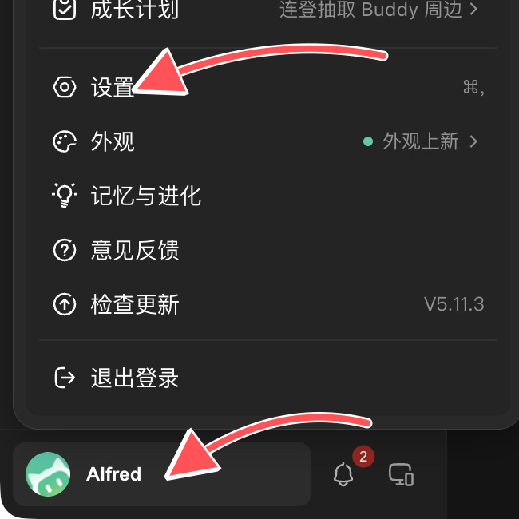
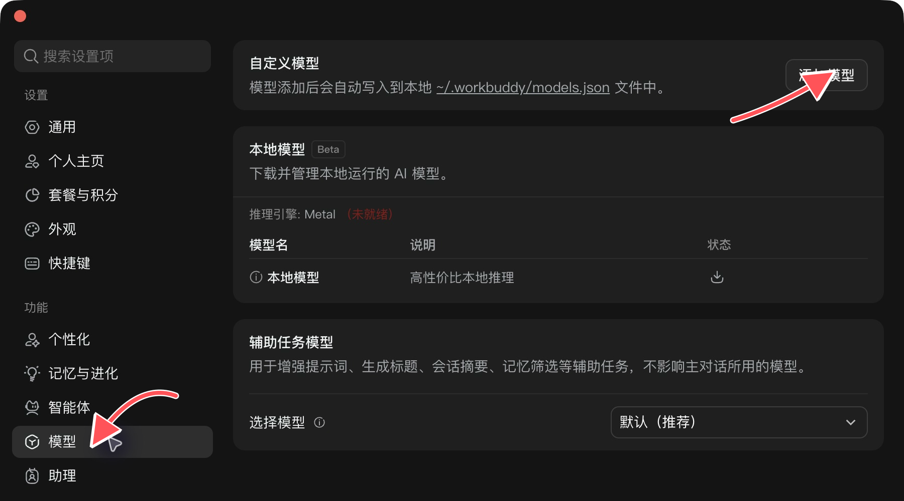
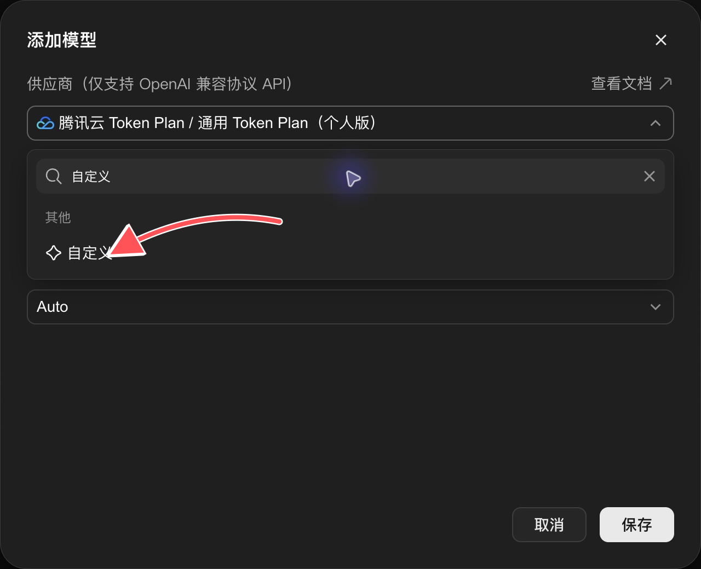
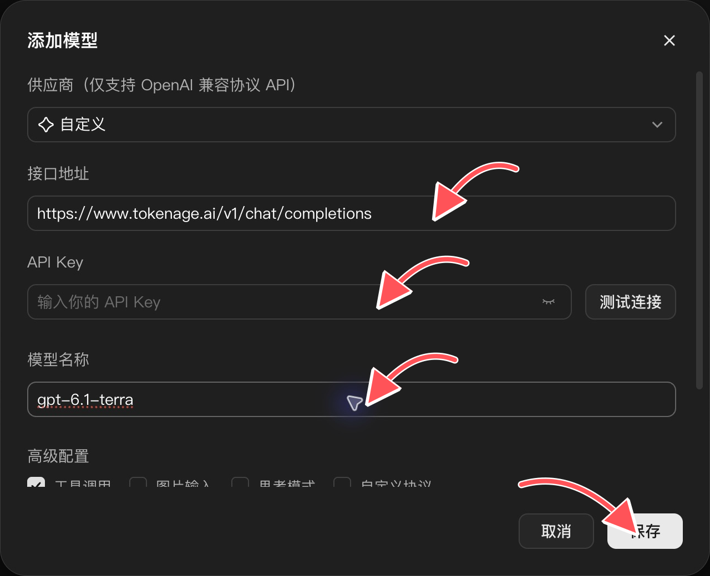

# WorkBuddy 接入 TokenAge 简明教程

> 截图来自 macOS 上的 WorkBuddy 5.11.3；不同版本界面可能略有区别。资料核对日期：2026-11-14。本文介绍配置方法，未实际添加密钥或测试付费调用。

## 1. 下载并安装 WorkBuddy

1. 打开 [WorkBuddy 官网](https://www.workbuddy.cn/)，点击「立即下载 WorkBuddy」，选择电脑对应的系统版本。
2. **Mac**：M 系列芯片选 ARM64，Intel 芯片选 X64。双击下载的 `.dmg`，将 WorkBuddy 拖入「应用程序」，复制完成后从「应用程序」打开。不要直接从磁盘映像运行，否则可能无法自动更新。
3. **Windows**：双击下载的安装包，按安装向导选择路径并完成安装。
4. 启动应用，按提示在浏览器登录，再返回 WorkBuddy。

参考：[Mac 安装指南](https://www.workbuddy.cn/docs/workbuddy/From-Beginner-to-Expert-Guide/Installation-Mac-Guide) · [Windows 安装指南](https://www.workbuddy.cn/docs/workbuddy/From-Beginner-to-Expert-Guide/Installation-Win-Guide)。

## 2. 准备 TokenAge 的信息

1. 打开 [TokenAge](https://www.tokenage.ai/)，注册并登录；根据平台要求准备可用额度。
2. 在平台的「API Keys」页面创建并复制 API Key，妥善保管，不要发给他人或写入共享文档。
3. 在模型广场搜索 `gpt-6.1-terra`，复制平台显示的**准确模型 ID**，并确认账户有使用权限；模型是否可用及价格以平台当前页面为准。

## 3. 在 WorkBuddy 添加模型

**第一步：打开设置。** 点击左下角头像，在弹出菜单中选择「设置」。

**第二步：添加模型。** 在设置左侧点击「模型」，再点击右上角「添加模型」。

**第三步：选择供应商。** 点击「供应商」下拉框，搜索并选择「自定义」。

**第四步：填写配置。**

- **接口地址**：`https://www.tokenage.ai/v1/chat/completions`
- **API Key**：粘贴第 2 步创建的 TokenAge 密钥。截图中为保护密钥而留空。
- **模型名称**：填写 `gpt-6.1-terra`；请核对 TokenAge 模型广场显示的准确 ID 及账户权限。

按模型实际能力设置「工具调用」「图片输入」「思考模式」；普通 OpenAI 兼容接口通常保持「自定义协议」关闭，输入和输出长度可先使用提供商默认值。点击 **测试连接**，成功后点击 **保存**。

> TokenAge 的 Base URL 是 `https://www.tokenage.ai/v1`，上面的 WorkBuddy「接口地址」填写的是 TokenAge 接入指南给出的完整聊天接口地址。勿重复拼接 `/v1` 或 `/chat/completions`。

## 4. 选择模型并验证

返回新建任务页面，点击输入框下方当前模型名称，在自定义模型中选择刚添加的 `gpt-6.1-terra`，发送「你好」测试。连接测试成功仍建议实际发送一次消息确认回复；调用可能按 TokenAge 的价格和账户规则计费。

如失败，依次检查：完整接口地址、API Key 是否有效、模型 ID 的拼写与账户权限、余额或额度，以及网络连接。图片或工具调用失败时，检查所选模型是否支持对应能力。配置和密钥保存在本机 WorkBuddy 的 `~/.workbuddy/models.json`；不要将该文件上传或分享。第三方模型请求会发送给所配置的服务，请先确认其服务协议和隐私政策。

参考：[TokenAge WorkBuddy 接入指南](https://www.tokenage.ai/docs/app-workbuddy) · [TokenAge 文档概览](https://www.tokenage.ai/docs) · [WorkBuddy 模型配置](https://www.workbuddy.cn/docs/workbuddy/From-Beginner-to-Expert-Guide/Function-Description/Model)。
